# 基于Python的Web安全检测系统的设计与实现

> 公开脱敏版：保留论文正文与技术插图；学校模板、页眉页脚、校徽、身份元数据不进入公开文件，含个人资料或凭据的截图已隐藏。

## 第1章 绪论

### 1.1 研究背景和意义

近年来，随着互联网技术的飞速发展，网络应用已经成为人们日常生活和商业运作中不可或缺的一部分。 随着对 Web 应用程序的依赖不断增加，网络攻击和安全漏洞的风险也在增加。 Web 安全已成为全球个人、企业和组织关注的一个重要问题。 越来越多的网络威胁和不断变化的 Web 漏洞状况使得拥有一个强大且最新的 Web 安全检测系统变得至关重要。

目前，市场上有很多商用的Web安全检测系统。 然而，这些系统往往价格昂贵，缺乏灵活性和定制选项，使得具有不同需求的用户难以充分发挥其潜力。 此外，网络攻击方式的快速演变需要使用者对现有的安全检测系统进行持续更新和改进，但是商业解决方案通常需要大量时间和金钱，这对中小型企业 (SME) 和个人用户来说是一个极大的负担。

在此背景下，人们越来越需要一种经济实惠、灵活且易于根据用户特定需求定制的网络安全检测系统。 使用Python等开源技术开发Web安全检测系统，可以为各种规模的个人和组织提供更易于访问和适应性强的解决方案。 Python 是一种流行且功能强大的编程语言，拥有庞大的库和框架生态系统，这使其成为构建 Web 安全检测系统的理想选择。 而且，Python的可读性和易用性使得开发者能够快速构建和维护系统。

总而言之，基于 Python 的 Web 安全检测系统的设计和实现可以提供一种经济实惠、灵活且可定制的解决方案，以解决日益增长的 Web 安全问题。 通过利用开源技术并采用模块化和可扩展的架构，拟议的系统不仅可以满足用户的多样化需求，还可以紧跟网络安全的最新趋势。[4] 该项目有可能为网络安全检测领域做出重大贡献，并帮助个人和组织更有效地保护其数字资产免受网络威胁

### 1.2 国内外研究现状

在国内外的网络安全领域，随着互联网技术的迅速发展和网络攻击手段的不断升级，网络安全检测系统已经成为了一个日益重要的议题。在全球范围内，各种规模的企业和组织都在寻找能够更好地保护他们的网络资产和信息系统的解决方案。

在国外，许多大型企业和政府机构已经开始采用成熟的网络安全检测系统，以确保他们的网络安全，Sworna, ZT等人（2023）基于日益复杂的攻击模型导致主机检测系统性能下降的情况，并通过识别、分类和系统地比较了HIDS中最先进的NLP方法使用，同时分析了流行做法、注意事项、优势和局限性以及未来发展方向。这些系统通常具有高度专业化的功能和实时更新的威胁情报，能够有效地预防和应对各种网络攻击。然而，这些商业化的解决方案往往价格昂贵且缺乏定制化能力，难以满足中小型企业和个人用户的需求。

在国内，网络安全领域也在迅速发展，孙凌洁、钟于胜等人（2009）认为网络系统漏洞包括协议本身的不足并且在操作系统和应用软件层面上有体现，通过探讨计算机网络漏洞的形成和产生，并在此基础上研究和设计了一个漏洞检测系统。越来越多的企业和组织意识到网络安全的重要性，开始投资于网络安全检测系统。虽然目前国内市场上的网络安全检测产品相对较少，但近年来出现了一些基于开源技术的解决方案，如基于Python的网络安全检测系统。王超（2007）认为入侵检测技术仍然处于发展阶段，网络安全发展应该更加深入全面多角度的研究入侵检测技术。这些系统相较于商业化产品而言，价格更加亲民且具有较高的定制化能力，为中小型企业和个人用户提供了一个更实用的选择。

然而，无论是国内还是国外，网络安全检测系统的发展仍然面临着诸多挑战。随着网络攻击手段的不断演变，现有的安全检测系统需要不断更新和优化以应对新的威胁。此外，为了确保网络安全，企业和组织需要在人员培训、制定合适的安全策略以及有效的安全意识宣传等方面投入更多的精力。

总之，国内外的网络安全检测系统发展现状表明，虽然已经取得了一定的进展，但仍然有很多工作需要做。为了应对日益严峻的网络安全挑战，我们需要继续研究和开发更先进、更实用的网络安全检测技术，同时在企业和组织层面加强网络安全意识和培训。

### 1.3 本文主要工作及章节安排

## 第一章：介绍系统的研究背景，阐述系统的研究目的，意义，讲述系统的国内外发展现状，分章节概述本文结构。

## 第二章：介绍本系统关键技术：Python，POC，Vue，HTTP请求，Nmap等

## 第三章：概述系统需要实现的功能目标，对系统功能进行需求分析，使用用例图描述系统用例。

第四章：系统设计，对本系统的功能进行设计，系统架构进行设计，阐述系统的数据库设计，讲述系统实现过程，贴出系统实现效果截图，对关键功能进行代码函数讲解。

## 第五章：系统测试，对系统进行黑盒测试，保证关键功能稳定运行。

## 第2章 关键技术介绍

### 2.1 服务端技术

### 2.1.1 Python

Python 是一种高级、动态类型的编程语言，自从 1991 年首次发布以来，已经成为全球范围内广泛应用的编程语言之一。Python 的特点包括简洁、易读、可扩展性强，以及拥有庞大的开源社区[1]。简洁性使得 Python 代码更容易理解和修改，对于开发网络安全检测系统这样需要频繁更新和维护的项目而言，Python 的易用性大大提高了开发效率这些优势使得 Python 成为了开发网络安全检测系统的理想选择。同时Python 拥有强大的标准库和丰富的第三方库，这些库为开发者提供了许多现成的功能和工具，可以大大减少开发工作量。[6]在网络安全领域，Python 社区已经为开发者提供了大量的安全相关库，如 Requests、BeautifulSoup、Scrapy 等用于网络爬虫，Nmap、Scapy 等用于网络扫描，以及 Django、Flask 等 Web 框架[1]。这些库简化了网络安全检测系统的开发过程，为开发者提供了丰富的资源。

### 2.1.2 Flask

Flask 是一款轻量级的 Python Web 框架，Flask 的优势在于其轻量化、模块化和易于扩展的特性。首先，Flask 本身只包含基本的 Web 应用功能，这使得它在性能上相对较高。其次，Flask 支持模块化开发，开发者可以根据需要引入或者编写自己的插件。这种模块化的设计方法让开发者可以在保持核心功能简洁的同时，灵活地添加或修改系统的功能。最后，Flask 的可扩展性意味着开发者可以轻松地根据实际需求调整应用程序的功能和性能。在网络安全检测系统中，Flask 能够提供高效的 Web 服务来处理客户端请求，并与后端安全检测模块进行交互。通过使用 Flask 提供的路由、模板引擎和静态文件处理功能，开发者可以快速搭建一个功能完善的网络安全检测系统的 Web 界面。此外，Flask 支持 RESTful API 设计，有助于实现前后端分离，便于系统的维护和升级。

### 2.1.3 Nmap

Nmap是一个网络连接端扫描软件，用来扫描网上电脑开放的网络连接端。确定哪些服务运行在哪些连接端，并且推断计算机运行哪个操作系统（这是亦称 fingerprinting）。[2]它是网络管理员必用的软件之一[6]。Nmap 常被跟评估系统漏洞软件Nessus 混为一谈。Nmap 以隐秘的手法，避开闯入检测系统的监视，并尽可能不影响目标系统的日常操作。

### 2.1.4 Redis

Redis（Remote Dictionary Server）是一种高性能、键值存储的内存数据库，通常用于缓存、消息队列和数据共享等场景。[2]Redis 支持多种数据结构，如字符串、列表、集合、哈希表和有序集合等，为各种应用提供了极大的灵活性。Redis 提供了如 LPUSH、RPUSH、LPOP 和 RPOP 等命令，用于实现高效的队列操作[7]。此外，Redis 还提供了阻塞版本的队列操作命令，如 BLPOP 和 BRPOP，可以让客户端在没有数据可取时等待，降低系统的资源消耗。

### 2.2 其他技术

### 2.2.1 Vue

Vue.js 是一款轻量级、高效且易于上手的 JavaScript 框架，用于构建用户界面和单页面应用。Vue 的核心特性包括声明式渲染、组件化、响应式数据绑定和虚拟 DOM，使得开发者能够更高效地构建可维护和可扩展的 Web 应用。Vue.js 支持插件系统和周边生态，例如 Vuex（状态管理）和 Vue Router（路由管理），进一步提升了其在复杂项目中的实用性。

### 2.2.2 MySQL数据库

MySQL 是一款广泛使用的开源关系型数据库管理系统（RDBMS），以其高性能、稳定性和易用性著称。它采用结构化查询语言（SQL）来存储、查询和管理数据。MySQL 支持多种存储引擎，如 InnoDB（事务安全）和 MyISAM（非事务安全），适用于不同类型的应用场景[8]。MySQL 提供了丰富的数据类型和索引功能，以便在大量数据中高效地检索信息。此外，MySQL 具有可扩展性和安全性，能够满足从小型应用到大型企业级应用的需求。

### 2.2.3 POC

POC（Proof of Concept，概念验证）是一种验证技术或系统可行性的方法，通常用于网络安全领域。通过编写特定的代码或脚本，攻击者或安全研究人员可以利用已知的漏洞来证明其存在和可利用性[8]。在安全检测系统中，POC 通常用于验证目标系统是否存在特定漏洞，从而帮助企业及时修复安全风险。POC 的使用不仅加速了漏洞发现和修复过程，还有助于提高安全研究人员对潜在威胁的认识[11]。然而，POC 也可能被滥用，导致未经授权的攻击行为，因此需要谨慎使用。

## 第3章 系统分析

### 3.1 系统概述

基于 Python 的 Web 安全检测系统的设计与实现需要满足以下功能需求：

扫描功能：系统应提供多种扫描方式，包括端口扫描、服务扫描、漏洞扫描等。通过使用 Nmap 等开源工具，可实现自动化、高效的扫描过程，帮助用户及时发现网络中的潜在安全隐患。

漏洞收集：系统需要具备漏洞收集功能，可根据扫描结果自动识别和归类漏洞信息。此外，系统还应支持手动输入漏洞信息，以便用户根据实际情况更新漏洞库。

资产收集：系统应能自动收集并整理目标网络中的资产信息，包括 IP 地址、操作系统、服务类型等。通过对资产信息的分析，用户可以更好地了解网络环境，为安全防护提供依据。

POC 命中：系统需要支持 POC（Proof of Concept）技术，根据已有的漏洞信息生成相应的 POC 脚本，并自动对目标系统进行验证。通过 POC 命中功能，用户可以快速确定目标系统是否存在特定漏洞，提高漏洞修复效率。

POC 管理：系统应提供 POC 管理功能，允许用户添加、删除、修改和搜索 POC 脚本。此外，系统还应支持对 POC 脚本进行分组和标签管理，以便用户快速查找和使用。

扫描管理：系统需要支持扫描任务的创建、执行、暂停、终止和删除。用户可以根据实际需求自定义扫描任务，设置扫描范围、扫描深度等参数。系统还应提供扫描进度监控和日志记录功能，方便用户实时了解扫描状态。

账号管理：系统需要支持账号管理，初始化的超级管理用户可以进行其他用户的增加删除与修改。

系统安全：为保证系统本身的安全性，需要采取一定的安全措施，如用户身份验证、访问控制、数据加密等。

通过以上需求分析，我们可以看出，基于 Python 的 Web 安全检测系统的设计与实现需要综合多种技术和工具，才能实现功能齐全、易用、高效的网络安全检测解决方案。

### 3.2 系统需求分析

### 3.2.1 功能需求分析

根据实际需求分析，得知本系统具有个人信息修改，系统登录，数据统计，目标管理，扫描管理，资产管理，漏洞管理，POC管理，账号管理等功能，系统功能结构图如图3-1所示。

图3-1 系统功能结构

目标管理：成功登入系统的用户可以进行目标查询（目标关键字，描述关键字，扫描状态，扫描进度），查询所有符合条件的目标，可以添加目标（目标地址，描述，端口扫描的类型，扫描的端口数量，POC并发量设置），添加后的目标，自动加入扫描队列中，扫描设置（指纹探测，子域名获取，端口扫描，目录扫描，POC检测）。

扫描管理：登录系统的用户可以进行数据查询，输入目标关键字，选择扫描状态，扫描进度，查询出符合条件的数据，然后可以操作这些数据：恢复扫描，暂停扫描，取消扫描。

资产管理：登入系统的用户可以查询系统中所有资产信息，可以通过目标关键字，IP关键字，端口关键字，Web框架关键字，标题关键字进行资产数据的筛选，可以对筛选出的结果进行删除与导出操作。

漏洞管理：登入系统的用户通过目标关键字，IP和端口关键字，漏洞关键字对本系统中所有命中的漏洞数据进行查询，对于目标主机已经解决的漏洞，可以进行删除操作，保持系统中的漏洞数据时刻为最新状态。

POC管理：登入系统的用户可以通过POC关键字对系统中存在的POC数据进行查询。

账号管理：登入系统的用户可以账号的添加，删除，查询，修改操作。

统计：系统首页目标，扫描次数，端口数量，漏洞数量进行统计，然后对漏洞信息进行饼状图与线条图的展示，然后以线条图的方式展示每周的扫描次数信息。

个人信息修改：登入系统的用户可以修改密码与头像，本系统的用例图如图3-2所示。

图3-2 用例图

### 3.2.2 非功能需求分析

易用性：系统应具有友好的用户界面和操作流程，以便用户快速上手和使用。对于复杂的功能和设置，应提供详细的说明和帮助文档，方便用户了解和掌握。

可扩展性：系统需要支持模块化和插件化设计，以便在不影响现有功能的前提下，轻松添加新的功能模块和扩展。这有助于满足不断变化的网络安全检测需求，为未来的升级和优化提供便利。

性能：系统应具备较高的性能，能够在短时间内完成大量的扫描任务。这需要优化扫描算法和并发策略，合理分配系统资源，避免过度消耗 CPU 和内存。

可靠性：系统需要具备良好的稳定性和可靠性，能够在各种网络环境和设备条件下正常工作。此外，系统应具备故障恢复能力，当出现异常或故障时，能够自动恢复或提示用户采取相应措施。

安全性：系统的安全性至关重要，需要采取多种安全措施，如加密通信、访问控制、防篡改等。同时，系统还应提供日志记录和审计功能，帮助用户追踪和分析潜在的安全问题。

兼容性：系统需要支持多种操作系统和浏览器，以适应不同用户的使用习惯和设备环境。此外，系统还应兼容各种网络协议和设备类型，确保扫描任务的全面性和准确性。

## 第4章 系统设计

### 4.1 架构设计

项目整体结构为B/S结构，前端由Vue提供交互支撑，服务端使用了Python的Flask框架，然后使用Redis与MySQL数据库进行了数据的永久持久化操作，其中Redis也是扫描任务调度支持，然后系统服务端实现了个人信息修改，系统登录，数据统计，目标管理，扫描管理，资产管理，漏洞管理，POC管理，账号管理功能，前端实现了这些功能的可视化界面，前端与服务端的交互使用了HTTP请求，请求的数据内容合适为JSON，系统的架构图如图4-1所示。

图4-1 系统架构图

架构技术描述如下所示：

（1）前端主要为浏览器，前端的逻辑实现使用了Vue框架，使用了ELM UI绘制前端页面。

（2）交互层为前端与服务端之间的数据交互，使用了POST与GET请求，请求的方式为HTTP，数据结构为JSON body。

（3）服务端的开发语言为Python，使用了Flask框架，服务端还使用了Nmap，Masscan与Socket。

（4）数据库使用了MySQL数据库与Redis，Redis调度系统中的扫描任务，MySQL存储POC，漏洞，资产，扫描任务，用户账号密码等数据。

### 4.2 主要流程设计

### 4.2.1 目标添加

定义一个异步函数 target_new，接收一个名为 request 的 VueRequest 类型参数。定义一个响应字典 response，包含三个键值对：code、message 和 data。使用 rsa_crypto.decrypt 函数解密收到的请求数据，将解密后的数据转换为 JSON 格式。提取请求中的目标、端口、令牌、速率、并发数、Masscan 命令、Nmap 命令和扫描器等字段。调用 mysqldusername 函数，根据令牌查询用户名。根据查询结果，执行不同的逻辑：如果结果为 'L1001'，则系统异常，返回相应的错误信息。如果结果为 None，则认证失败，返回相应的错误信息。如果查询成功，将任务添加到高优先级队列中，并返回请求成功的信息。使用 try-except 语句包裹整个过程，捕获可能发生的异常。如果出现异常，返回系统异常的错误信息，时序图如图4-2所示。

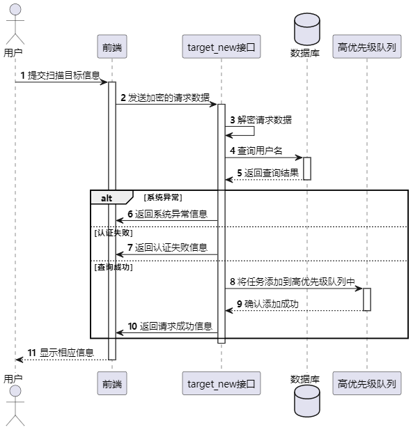

图4-2 目标添加时序图

### 4.2.3 扫描

扫描分为两步，首先是端口的获取，初始化一个空的扫描列表 scan_list。创建一个新的 asyncio 事件循环，并设置为当前事件循环。设置 Nmap 的默认扫描命令，除非传入了自定义命令 cmd。尝试使用 nmap.PortScanner 类创建一个扫描器对象，并设置扫描参数。针对每个扫描到的主机和协议，获取并排序端口列表。如果端口数量小于 50，则对每个端口执行以下操作：提取协议、产品和版本信息。如果协议不包含 "tcpwrapped"，则进一步检查协议是否为 HTTP 类型。根据协议和端口设置 scan_url_port。查询所有指纹数据，使用 Fofa_Scanner 类获取 CMS 指纹。获取网站标题，并将结果保存到数据库。如果发生任何异常，使用 try-except 语句捕获并跳过返回扫描列表 scan_list，时序图如图4-3所示。

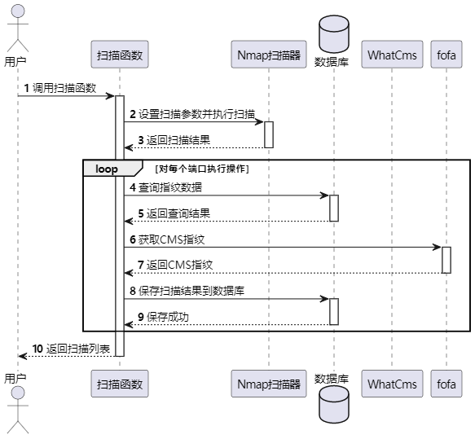

图4-3 端口数据获取

获取到端口数据后，进行POC函数，获取目标主机暴露的漏洞信息，为了提高系统的运行效率，POC漏洞获取的执行方式为多线程，调用 ThreadPoolExecutor 设置并发线程数量（例如 500）并创建一个新的事件循环，设置一个协程信号量，以限制并发协程的数量，遍历扫描列表，针对每个目标（ip_port），根据目标类型选择加载 http 或 port 类型的 POC 插件，从数据库中获取目标端口的指纹信息，根据指纹信息选择适当的 POC 插件路径，如果没有找到匹配的指纹路径，则加载所有 POC 插件，遍历选定的 POC 插件路径，加载插件并创建一个新的协程任务。将任务添加到任务列表，使用 asyncio.gather() 函数，等待所有任务完成，所有任务执行完成后，将数据插入数据库中，时序图如图4-4所示。

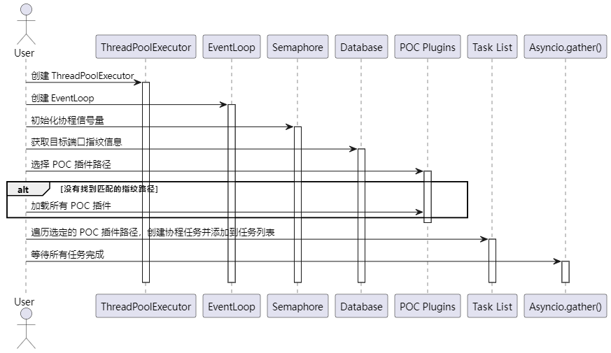

图4-4 POC

### 4.3 数据库设计

通过对上述主要功能设计与需求分析章节可以得知本系统需要有用户表，扫描表，目标表，资产表，漏洞表，POC表，CMS指纹表，本系统使用阿里规范，并且创建表时，使用了三段式，因此表与表之间的外键关系均在业务中实现，不适用实体外键，由于篇幅有限，本小结主要阐述用户表，POC表，目标表等，除了上述表格，本系统还需要设计一些辅助性的表格，比如权限表、日志表等，以支持系统的安全性和可维护性。同时，三段式设计也使得数据库的可拓展性更强，能够满足系统随着业务的发展需要对数据结构进行调整的情况。总之，系统的数据库设计是保证系统运行稳定、高效和可扩展的基础之一。

POC表如表4-1所示，POC表中的字段包括漏洞名称、漏洞类型、漏洞等级、漏洞描述、POC插件路径等信息，这些信息用于支持系统的漏洞扫描功能。通过POC表，系统可以快速准确地识别目标漏洞，并进行漏洞验证和修复。同时，POC表也为安全研究人员提供了一个可靠的POC漏洞库，方便安全研究人员开展漏洞研究和攻击模拟，实体图如图4-5所示。

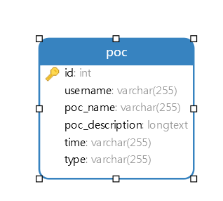

图4-5 POC实体

表 4-1 POC表

<table>
<tr><td>序号</td><td>字段名</td><td>类型</td><td>字段含义</td></tr>
<tr><td>1</td><td>id</td><td>int NOT NULL AUTO_INCREMENT</td><td>主键ID</td></tr>
<tr><td>2</td><td>username</td><td>varchar(255)</td><td>用户名</td></tr>
<tr><td>3</td><td>poc_name</td><td>varchar(255)</td><td>POC 名称</td></tr>
<tr><td>4</td><td>poc_description</td><td>longtext</td><td>POC 描述</td></tr>
<tr><td>5</td><td>time</td><td>varchar(255)</td><td>时间</td></tr>
<tr><td>6</td><td>type</td><td>varchar(255)</td><td>类型</td></tr>
</table>

资产表如表4-2所示，资产表是存储目标扫描后的一些端口数据信息的表格，包括指纹信息、端口、IP地址等，这些信息对于系统的安全评估和漏洞检测具有重要作用。在资产表中，可以根据不同的条件进行查询和分析，帮助管理员快速了解目标资产的情况，并进行相应的安全策略制定和漏洞修复，如图4-6所示。

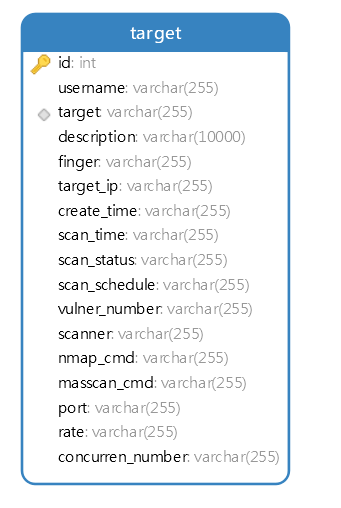

图4-6 资产实体

表 4-2 资产表

<table>
<tr><td>序号</td><td>字段名</td><td>类型</td><td>字段含义</td></tr>
<tr><td>1</td><td>id</td><td>int NOT NULL AUTO_INCREMENT</td><td>主键ID</td></tr>
<tr><td>2</td><td>username</td><td>varchar(255)</td><td>用户名</td></tr>
<tr><td>3</td><td>target</td><td>varchar(255)</td><td>目标</td></tr>
<tr><td>4</td><td>ip_port</td><td>varchar(255)</td><td>IP 和端口</td></tr>
<tr><td>5</td><td>scan_time</td><td>varchar(255)</td><td>扫描时间</td></tr>
<tr><td>6</td><td>scan_ip</td><td>varchar(255)</td><td>扫描 IP</td></tr>
<tr><td>7</td><td>port</td><td>varchar(255)</td><td>端口</td></tr>
<tr><td>8</td><td>finger</td><td>varchar(255)</td><td>指纹</td></tr>
<tr><td>9</td><td>product</td><td>varchar(255)</td><td>产品</td></tr>
<tr><td>10</td><td>protocol</td><td>varchar(255)</td><td>协议</td></tr>
<tr><td>11</td><td>version</td><td>varchar(255)</td><td>版本</td></tr>
<tr><td>12</td><td>title</td><td>varchar(255)</td><td>标题</td></tr>
<tr><td>13</td><td>banner</td><td>varchar(255)</td><td>横幅</td></tr>
</table>

目标表如表4-3所示，主要存储用户创建的扫描目标信息，比如端口扫描的方式，扫描的深度，POC扫描的深度，目标表还包含了目标名称、目标描述和创建时间等字段，用于帮助用户更好地管理自己的扫描目标，如图4-7所示。

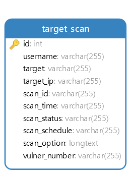

图4-7 目标实体

表 4-3 目标表

<table>
<tr><td>序号</td><td>字段名</td><td>类型</td><td>字段含义</td></tr>
<tr><td>1</td><td>id</td><td>int NOT NULL AUTO_INCREMENT</td><td>主键ID</td></tr>
<tr><td>2</td><td>username</td><td>varchar(255)</td><td>用户名</td></tr>
<tr><td>3</td><td>target</td><td>varchar(255)</td><td>目标</td></tr>
<tr><td>4</td><td>description</td><td>varchar(10000)</td><td>描述</td></tr>
<tr><td>5</td><td>finger</td><td>varchar(255)</td><td>指纹</td></tr>
<tr><td>6</td><td>target_ip</td><td>varchar(255)</td><td>目标 IP</td></tr>
<tr><td>7</td><td>create_time</td><td>varchar(255)</td><td>创建时间</td></tr>
<tr><td>8</td><td>scan_time</td><td>varchar(255)</td><td>扫描时间</td></tr>
<tr><td>9</td><td>scan_status</td><td>varchar(255)</td><td>扫描状态</td></tr>
<tr><td>10</td><td>scan_schedule</td><td>varchar(255)</td><td>扫描进度</td></tr>
<tr><td>11</td><td>vulner_number</td><td>varchar(255)</td><td>漏洞数量</td></tr>
<tr><td>12</td><td>scanner</td><td>varchar(255)</td><td>扫描器</td></tr>
<tr><td>13</td><td>nmap_cmd</td><td>varchar(255)</td><td>Nmap 命令</td></tr>
<tr><td>14</td><td>masscan_cmd</td><td>varchar(255)</td><td>Masscan 命令</td></tr>
<tr><td>15</td><td>port</td><td>varchar(255)</td><td>端口范围</td></tr>
<tr><td>16</td><td>rate</td><td>varchar(255)</td><td>扫描速率</td></tr>
<tr><td>17</td><td>concurren_number</td><td>varchar(255)</td><td>并发数量</td></tr>
</table>

用户表如表4-4所示，用来存储用户数据，主要字段为token，password，role，来区分登入系统的角色与通过token获取当前用户的所有信息，如图4-8所示。

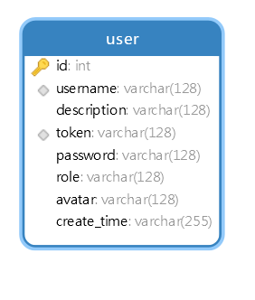

图4-8 用户实体

表 4-4 用户表

<table>
<tr><td>序号</td><td>字段名</td><td>类型</td><td>字段含义</td></tr>
<tr><td>1</td><td>id</td><td>int NOT NULL AUTO_INCREMENT</td><td>主键ID</td></tr>
<tr><td>2</td><td>username</td><td>varchar(128)</td><td>用户名</td></tr>
<tr><td>3</td><td>description</td><td>varchar(128)</td><td>用户描述</td></tr>
<tr><td>4</td><td>token</td><td>varchar(128)</td><td>用户令牌</td></tr>
<tr><td>5</td><td>password</td><td>varchar(128)</td><td>用户密码</td></tr>
<tr><td>6</td><td>role</td><td>varchar(128)</td><td>用户角色</td></tr>
</table>

## 第5章 系统实现

### 5.1 系统实现

### 5.1.1 登录

登录界面如图5-1所示，界面整体为Form表单，使用Vue的双向绑定获取数据，首先在data中定义登录表单Form：loginForm，然后为loginForm定义账号对象与密码对象，在表单代码中使用：model进行值得双向绑定，然后在点击事件handleLogin中，使用dispatch函数进行登录接口得访问：user/login，传入参数loginFrom，服务端接口对应得函数login中，首先使用rsa_crypto.decrypt函数解密前端得body内容，然后使用json.loads将其转为json对象，访问mysqldb.login方法进行参数验证，执行查询语句，验证通过后返回成功状态码，前端通过this.$router.push函数跳转系统首页。

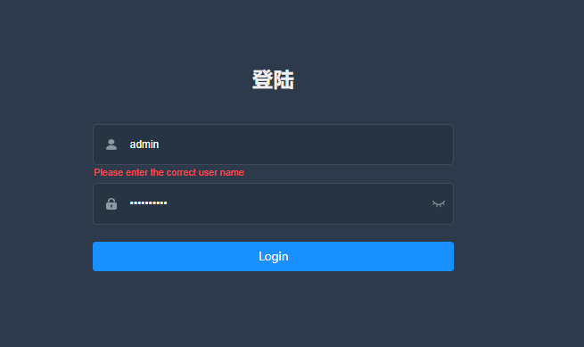

图 5-1 系统登录

### 5.1.2 目标管理

目标添加界面如图5-2所示，当用户点击目标管理列表页面中的添加目标按钮后，前端使用el-dialog组件，显示出新建弹窗，弹窗整体也是一个EL Form表单，当用户输入完所有的目标信息后，点击确认按钮，系统访问服务端接口：/api/target/new，进行新目标的添加，在服务端target_new函数中，通过rsa_crypto.decrypt函数与json.loads函数对request数据进行解密与JSON序列化，然后依次获得用户输入的数据，最后调用high_queue.enqueue_call(queue_target_list, args = (username_result['username'], target_list, request['description'], port, scanner, rate, concurren_number, masscan_cmd, nmap_cmd, mysqldb,), timeout = 7200000)函数，将目标任务添加进high_queue的任务队列中，其中enqueue_call()为该任务队列中需要执行的方法，这里为queue_target_list,，args为执行的参数，在queue_target_list函数中，将目标数据存入目标表中。

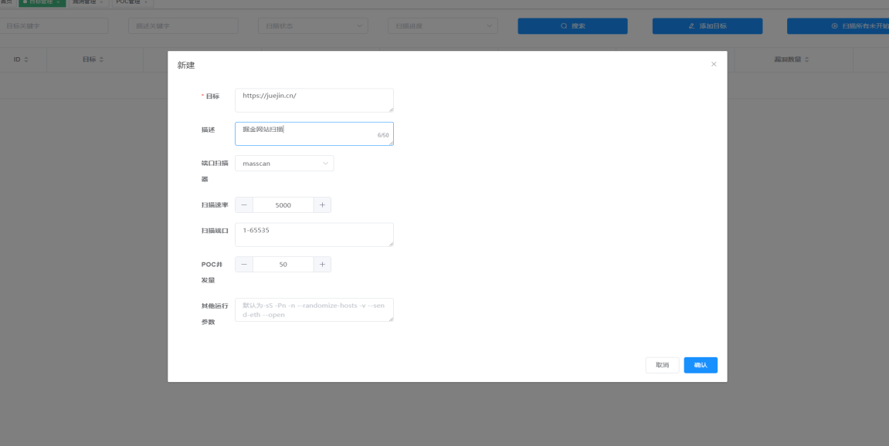

图 5-2 目标添加

目标列表如图5-3所示，当用户成功添加目标后，访问接口/target/list获取系统数据库中所有目标信息，前端使用el-table组件进行列表的渲染，然后为每列数据绑定操作按钮与监听事件：handleScan开始扫描，handleScanSet扫描设置，handleDelete删除。

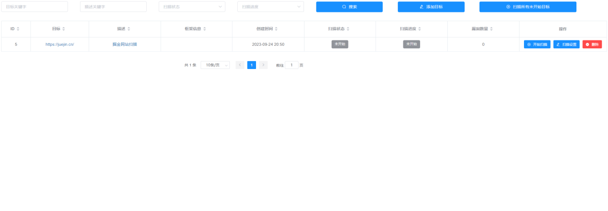

图 5-3 目标列表

### 5.1.3 扫描管理

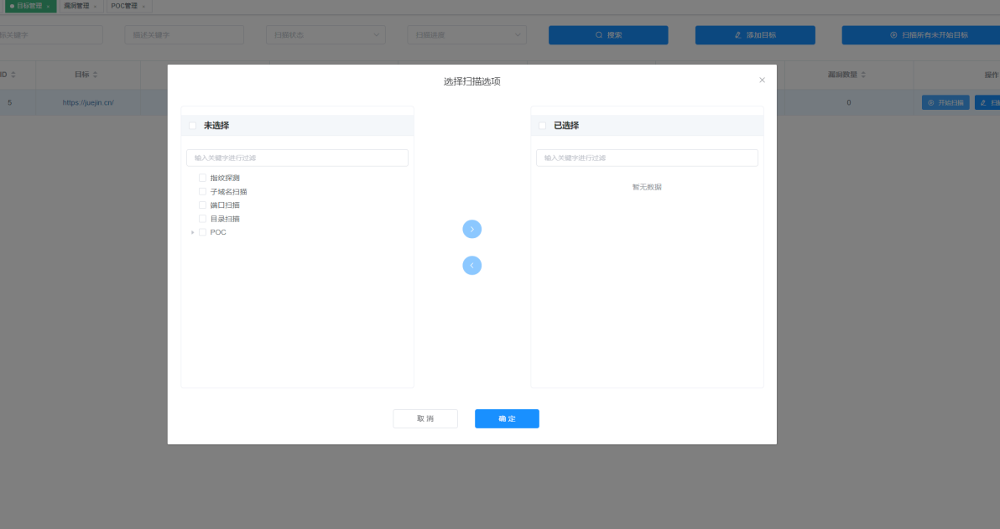

图 5-4 开始扫描

用户在目标管理界面点击开始扫描，系统弹出弹窗，让用户进行扫描设置，如图5-4所示，用户选择所有数据后，访问服务端接口/api/scan/start，服务端操作扫描表，并设置状态为扫描中，然后用户等待扫描结果，扫描列表如图5-5所示。扫描是由Redis调度RQ任务队列完成，首先在Redis中填充此次扫描的任务，然后由RQ进行扫描开始，扫描的函数为多线程，扫描的主函数为scan.run，在主函数中从参数中获取扫描设置、目标和选项。判断目标类型（IP 或 域名）。如果选项中包含指纹探测任务，则执行指纹探测。如果目标是域名且选项中包含子域名探测任务，则执行子域名探测。如果选项中包含端口扫描任务，则根据设置执行 Nmap 或 Masscan 扫描。如果选项中包含目录扫描任务，则针对所有满足条件的 URL 执行目录扫描。如果选项中包含 POC 扫描任务，则执行 POC 扫描。更新数据库中目标的扫描状态和进度。整个流程会根据输入的参数（如用户、目标、扫描 ID 等）以及选项（如指纹探测、子域名探测等）来执行不同的扫描任务，并在任务完成后更新数据库中的相关信息。

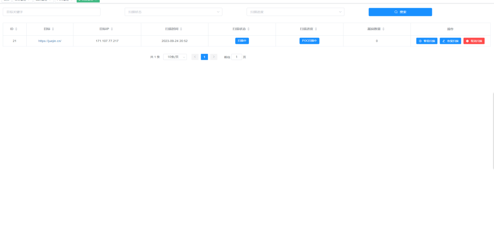

图 5-5 扫描列表

### 5.1.4 资产管理

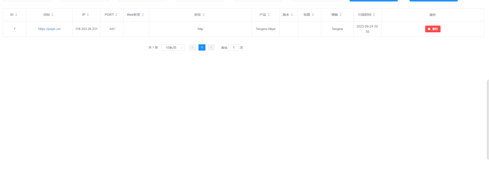

图 5-6 资产列表

Python服务端通过FastAPI的路由装饰器@router.post('/list')定义了一个HTTP POST请求端点，路径为/list，用于处理客户端请求。当客户端发送POST请求到/list端点时，这段代码会处理请求。请求数据通常以JSON格式发送。服务端尝试解密请求中的token数据，然后验证其有效性。这可能包括将token与数据库中的用户信息进行比对，确保请求合法性。根据验证后的信息，代码调用数据库（可能是MySQL）来检索与用户名、分页参数(pagenum和pagesize)以及查询条件(list_query)相关的端口信息。查询结果存储在port_list中，总数存储在total中。根据数据库查询结果，代码构建一个响应对象，其中包括响应代码(code)、响应消息(message)、总数(total)以及查询结果(data)。响应数据将以JSON格式返回给前端应用程序，前端使用EML UI的table组件对数据进行渲染展示，展示扫描阶段通过Namp获取到目标站点的端口数据信息。

点击目标可以看该目标小的所有详细信息，查看子域名，端口，目录与漏洞信息，如图5-7所示。

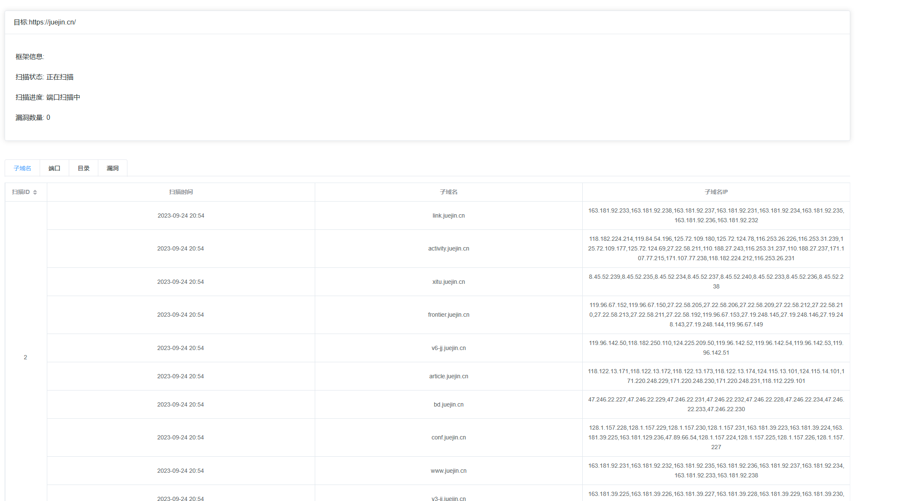

图 5-7 目标详细信息

### 5.1.5 漏洞管理

漏洞管理界面如图5-8所示，用户可以查看目标扫描出的漏洞数据信息，可以对其进行删除操作，表示已经解决这个漏洞。

图 5-8 漏洞管理

### 5.1.6 POC管理

POC列表界面如图5-9所示，用户可以查看本系统中所有POC数据，并且可以对其进行名字，描述，类型模糊查询，实现方式为SQL语句中的Like关键字，当用户输入内容后，点击搜索，前端请求接口/api/poc/list，接口进行模糊查询，然后数据，前端使用table组件对数据进行循环渲染展示。

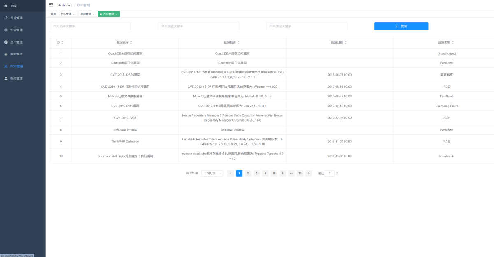

图 5-9 POC列表

### 5.1.7 统计

统计界面如图5-10所示，用户可以在此界面查看系统目标数量，目标对应的漏洞数量，端口数量等数据，并且可以查看由V-charts组成的扫描时间线条图，漏洞，目标数量，端口数量组成的饼状图与柱状图，服务端提供两个接口：

/card接口：用于获取首页卡片上的数据。它解密请求中的数据，验证令牌，然后根据令牌对应的用户名查询数据库，以获取卡片数据的计数。最后，它构建一个包含响应代码、消息和数据的JSON响应对象。

/7day接口：用于获取首页卡片上的曲线图数据。类似于/card端点，它解密请求，验证令牌，查询数据库，以获取过去7天的数据计数，并构建JSON响应对象。

前端接受到JSON对象后，通过V-charts组件渲染线条图与饼状图数据，使其更为直观的展示本系统的扫描数据信息。

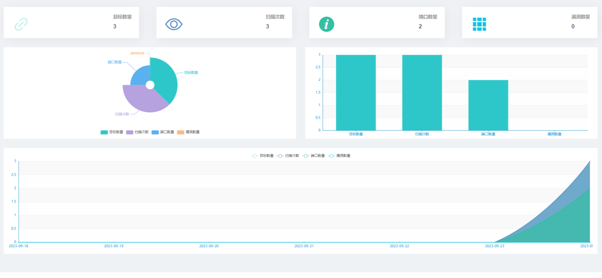

图 5-10 统计

### 5.2 可行性分析

使用 Flask、Vue、Redis、MySQL 等技术，可以构建一个高效且稳定的 Web 安全检测系统。Flask 作为一个轻量级的 Web 框架，可以简化系统开发过程，提高开发效率。Vue 提供了强大的前端开发能力，可实现友好的用户界面和交互。Redis 是一款高性能的内存数据库，支持队列模式，可以用于存储和处理扫描任务数据。MySQL 作为一款成熟的关系型数据库，可以用于存储资产信息、漏洞信息等。综合利用这些技术，可以实现一个功能完善、性能优越的 Web 安全检测系统。

网络安全已成为社会关注的焦点，各类企业和个人都在积极寻求有效的安全检测工具来保护自己的网络资产。基于 Python 的 Web 安全检测系统能够帮助用户识别潜在的安全漏洞，提高网络安全防护能力。同时，该系统采用开源技术，降低了使用成本，使得更多的企业和个人能够承受。因此，从社会需求的角度来看，开发这样一个系统具有较高的可行性。

市场上虽然已有一些网络安全检测产品，但大部分为商业化产品，价格较高且缺乏定制化能力。基于 Python 的 Web 安全检测系统采用开源技术构建，具有较低的成本和较高的定制化能力，有望填补市场空白。此外，随着互联网技术的发展，网络安全需求不断增长，市场规模也在不断扩大。这为基于 Python 的 Web 安全检测系统提供了广阔的市场空间和发展潜力。

## 第6章 系统测试

### 6.1 测试环境与方法

系统的测试环境为部署环境，由于本系统的扫描模块是在Linux下进行，因此系统服务端的运行使用了Docker，首先在Windows中安装Docker，然后编写Docker配置文件，将MySQL，Redis与服务端App编写进配置文件中，然后启动Docker容易，并将容器的端口映射到开发主机8000上，然后前端使用Node中的NPM模块进行编译，运行前端项目。

系统测试方法使用了黑盒测试方法，对登录，目标添加，扫描这三个功能进行黑盒测试。

### 6.2 功能测试

### 6.2.1 登录

登录测试用例主要测试系统登录接口是否对用户输入的账号与密码进行判断，验证服务端的判断逻辑是否与设计一致，验证前端是否做了判空逻辑，登录测试结果如表6-1所示。

表6-1 登录表

<table>
<tr><td>序号</td><td>测试步骤</td><td>结果</td><td>是否通过</td></tr>
<tr><td>1</td><td>用户没有输入，进行登录</td><td>前端拦截，提示请输入信息</td><td>通过</td></tr>
<tr><td>2</td><td>用户输入错误的账号，正确的密码进行登录</td><td>提示账号错误</td><td>通过</td></tr>
<tr><td>3</td><td>用户输入正确的账号与密码进行系统登录</td><td>登录成功，返回数据库中的token</td><td>通过</td></tr>
<tr><td>4</td><td>用户输入正确的账号与错误的密码进行系统登录</td><td>登录失败，提示密码错误</td><td>通过</td></tr>
<tr><td>5</td><td>用户输入不存在的账号进行登录</td><td>应提示账号不存在</td><td>通过</td></tr>
</table>

### 6.2.2 目标添加

根据测试结果表6-2，系统能够正常添加目标，并且目标能够成功加入到队列中并且存入到数据库中。这表明系统的目标管理功能实现了预期的功能，并且系统能够处理大量目标扫描任务，具有较高的可靠性和稳定性。

表6-2 目标添加

<table>
<tr><td>序号</td><td>测试步骤</td><td>结果</td><td>是否通过</td></tr>
<tr><td>1</td><td>用户没有进行任何输入</td><td>前端拦截，提示请输入信息</td><td>通过</td></tr>
<tr><td>2</td><td>用户输入目标ip地址127.0.0.1，选择扫描方式为nmap</td><td>添加成功</td><td>通过</td></tr>
<tr><td>3</td><td>第二步操作，用户输入的数据由队列添加数据库</td><td>添加成功</td><td>通过</td></tr>
</table>

### 6.2.3 资产管理

主要进行资产的查询，查看目标扫描的结果，测试结果如表6-3所示。

表63 资产管理

<table>
<tr><td>序号</td><td>测试步骤</td><td>结果</td><td>是否通过</td></tr>
<tr><td>1</td><td>用户查询特定资产信息</td><td>显示与查询条件匹配的资产信息</td><td>通过</td></tr>
<tr><td>2</td><td>用户尝试查看所有资产列表</td><td>该显示系统中所有资产的清单</td><td>通过</td></tr>
<tr><td>3</td><td>用户尝试删除特定资产</td><td>成功删除资产并从系统中移除</td><td>通过</td></tr>
<tr><td>4</td><td>用户尝试导出资产列表或特定资产信息为CSV或Excel文件</td><td>成功导出，并且文件内容格式正确</td><td>通过</td></tr>
</table>

### 6.2.3 扫描

测试用户是否可以正常暂停，恢复，取消扫描，能否正常的识别目标主机开放的端口，识别目标主机开发的端口对应的Web服务，识别是否命中POC中的漏洞，首先准备目标主机119.3.237.159，开发端口3306，80，80端口对应织梦CMS，然后暴露漏洞ThinkPHP，测试结果如表6-4所示。

表64 扫描

<table>
<tr><td>序号</td><td>测试步骤</td><td>结果</td><td>是否通过</td></tr>
<tr><td>1</td><td>用户暂停扫描1</td><td>暂停成功</td><td>通过</td></tr>
<tr><td>2</td><td>用户恢复扫描1</td><td>恢复成功</td><td>通过</td></tr>
<tr><td>3</td><td>用户开始扫描2</td><td>开始成功</td><td>通过</td></tr>
<tr><td>4</td><td>获取扫描结果</td><td>识别到了端口3306，MySQL数据库，识别到了80端口对应的织梦CMS，检测了ThinkPHP漏洞</td><td>通过</td></tr>
</table>

## 第7章 总结和展望

### 7.1 总结

本文主要介绍了一款基于 Python 的 Web 安全检测系统的设计与实现。通过集成 Flask、Vue、POC、Nmap、Redis 等开源技术，实现了具有前后端分离特性的网络安全检测系统。该系统具有扫描、资产收集、漏洞查看、POC 管理、扫描管理等功能，为网络安全提供了有力保障。

系统主要包括以下几个部分：

前端界面：使用 Vue.js 框架构建的单页应用（SPA），提供直观的用户操作界面。

后端服务器：基于 Flask 框架实现的 RESTful API，处理前端的请求并与数据库进行交互。

数据库：使用 Redis 作为数据库系统，存储扫描结果、资产信息、漏洞数据等。

扫描引擎：集成 Nmap 和 POC（Proof of Concept）技术，负责执行网络扫描、资产收集、漏洞检测等任务。

系统的核心功能包括：

网络扫描：利用 Nmap 对目标网络进行端口扫描，收集开放端口及其对应的服务信息。

资产收集：对扫描到的开放端口进行深度探测，获取详细的资产信息，如操作系统、软件版本等。

漏洞查看：根据扫描结果，查询已知漏洞库，展示目标网络中存在的安全漏洞。

POC 管理：通过 POC 技术实现针对特定漏洞的自动化验证，提供更准确的安全评估。

扫描管理：用户可以自定义扫描任务，对目标网络进行定期或实时的安全检测。

通过这款基于 Python 的 Web 安全检测系统，用户可以对目标网络进行全面的安全评估，发现潜在的安全隐患，并及时采取相应措施进行修复，从而提高网络安全防护能力。

### 7.1 展望

在基于 Python 的 Web 安全检测系统的设计与实现基础上，后续工作主要包括以下方面：

1. 持续更新和优化漏洞库，以提高漏洞检测的准确性和覆盖范围；

2. 引入机器学习和人工智能技术，提高漏洞发现和风险评估的智能化程度；

3. 完善扫描任务的调度和管理功能，以实现更灵活的自动化扫描；

4. 加强与其他网络安全工具和平台的集成，打造更完善的安全生态；

5. 持续关注网络安全领域的新技术和趋势，不断优化和升级系统功能，以满足不断变化的安全需求。
